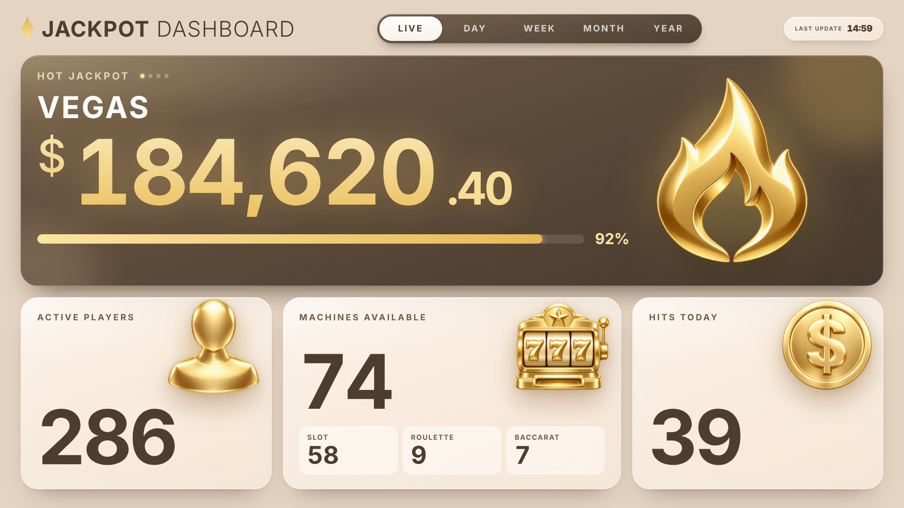
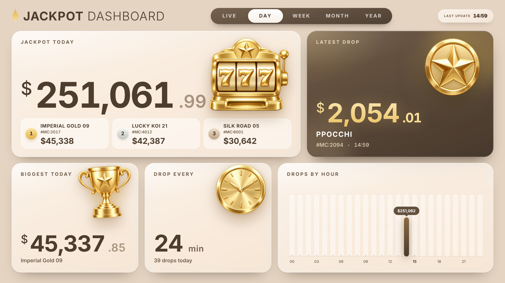
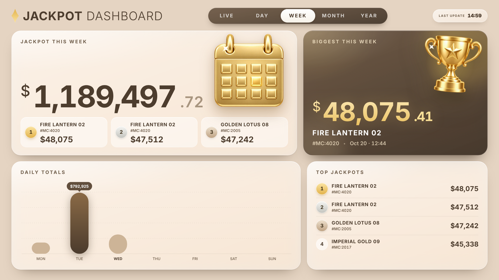
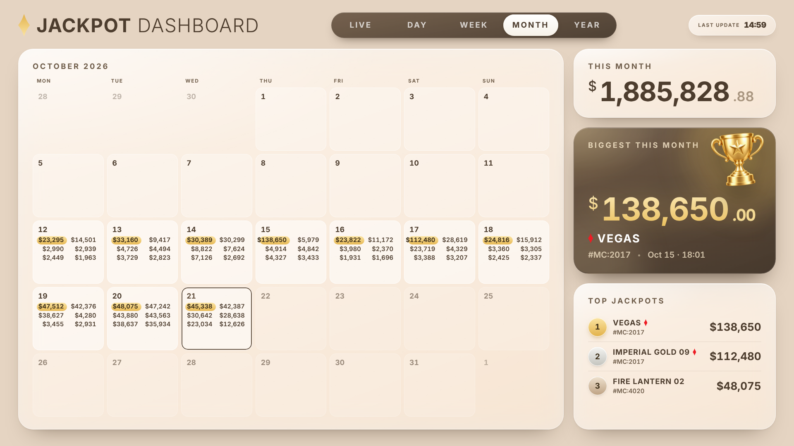
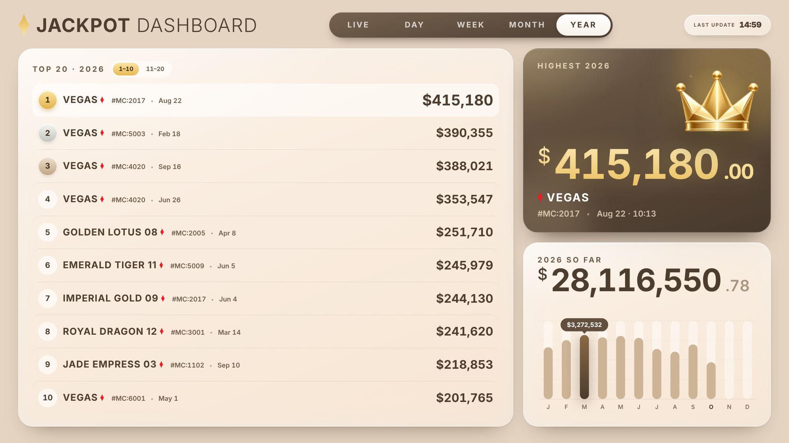

# Vegas Club · Jackpot Dashboard + On Air

Màn hình trình chiếu 16:9 (1920×1080) cho sảnh Vegas Club, gồm 2 phần:

- **Jackpot Dashboard**: 5 tab tự xoay vòng (Live, Day, Week, Month, Year).
- **ON AIR**: trang riêng hiện Pit Boss và các Game Host đang trong ca. Trang này chiếu ngay sau dashboard.

Toàn bộ là HTML/CSS/JS thuần trong **một file**: không framework, không bước build.

*A 1920×1080 lobby display for Vegas Club: rotating jackpot dashboard (Live / Day / Week / Month / Year) plus an "On Air" page showing who is dealing right now. Single-file vanilla HTML/CSS/JS, no build step.*

| Live | Day | Week |
|---|---|---|
|  |  |  |
| **Month** | **Year** | **On Air** |
|  |  |  |

## 1. Cấu trúc repo

```
index.html                     Bản đầy đủ: dashboard + ON AIR + cài đặt (chạy demo khi mở trực tiếp / GitHub Pages)
on-air.html                    Chỉ riêng ON AIR (lưu localStorage, có ghi chú tích hợp ở đầu file)
assets/
  icons/*.webp                 10 icon vàng 3D (đã nhúng sẵn trong HTML dạng data URI)
  brand/diamond.svg            Logo kim cương Vegas Club
data/sample/                   Dữ liệu mẫu đúng cấu trúc app đọc/ghi (mỗi document là 1 file JSON)
  _all-documents.json          Toàn bộ document gộp thành 1 map { "<path>": {...} }
docs/screenshots/              Ảnh chụp từng màn hình
```

> Repo công khai: danh sách nhân viên trong code và dữ liệu mẫu chỉ là **tên giả, không có ảnh**.
> Ảnh và tên thật của nhân viên không đưa lên đây; khi triển khai, nạp chúng qua màn hình Cài đặt → On Air hoặc từ backend.

## 2. Chạy thử

Mở `index.html` bằng Chrome hoặc Edge (hoặc bật GitHub Pages, xem mục 10) rồi nhấn **F** để toàn màn hình.

- Khi không có backend, app chạy **chế độ demo**: dữ liệu mẫu nằm trong bộ nhớ, tải lại trang là mất thay đổi.
- Font Montserrat tải từ Google Fonts. Máy chiếu chạy offline thì cần host font nội bộ.

**Phím tắt**

| Phím | Tác dụng |
|---|---|
| `S` hoặc `Ctrl/Cmd + ,` | Mở cài đặt |
| `Esc` | Đóng cài đặt |
| `←` `→` | Chuyển tab |
| `Space` | Tạm dừng xoay vòng |
| `F` | Toàn màn hình |
| Giữ tiêu đề 1,5 giây | Mở cài đặt (màn hình cảm ứng) |

## 3. Màn hình và luật xoay vòng

**Thứ tự:** Live → Day → Week → Month → Year → On Air → lặp lại.

- **Thời gian mỗi tab:** mặc định 10 giây, chọn được 10/15/20/30/60 giây (lưu ở localStorage của từng máy).
- **Live:** đứng `max(interval, số Hot Jackpot × 5 giây)`.
- **Year:** chiếu 2 trang, 1–10 rồi 11–20.
- **Tab tự ẩn khi:**
  - bị tắt trong cài đặt;
  - mọi khung của tab đó đều bị ẩn;
  - riêng On Air: không có ai trong ca.

| Tab | Nội dung |
|---|---|
| **Live** | Hot Jackpot: slideshow các pool đạt ≥ 90%, mỗi pool 5 giây; nếu chưa pool nào đạt 90% thì hiện pool gần nhất. Kèm Active Players, Machines Available (Slot / Roulette / Baccarat) và Hits Today. |
| **Day** | Tổng hôm nay + top 3, Latest Drop, Biggest Today, Drop Every (thời gian trung bình giữa 2 lần trúng), Drops by Hour. |
| **Week** | Tổng tuần (thứ Hai → Chủ nhật) + top 3, Biggest This Week, Daily Totals, Top Jackpots. |
| **Month** | Lịch tháng: mỗi ô hiện tối đa 6 jackpot lớn nhất, ô lớn nhất được tô vàng. Kèm This Month, Biggest This Month, Top Jackpots. |
| **Year** | Top 20 của năm, Highest, Year So Far theo tháng. |
| **On Air** | Pit Boss của ca chính hiện tại + mọi Game Host đang trong giờ làm (xem mục 6). |

**Hiệu ứng khi có jackpot mới:**

- Khung Latest Drop rung nhẹ và có pháo hoa bên trong.
- Đồng xu bay vào ô tổng hôm nay, số tổng chạy tăng dần.

**Quy tắc hiển thị:**

- Kim cương đỏ chỉ dùng cho jackpot từ **100.000 USD** trở lên (`BIG = 100000`).
- Số máy hiển thị dạng `#MC:<mc>`.

## 4. Kiến trúc và điểm tích hợp

**Canvas và giao diện**

- Canvas cố định 1920×1080, scale theo cửa sổ (`--s = min(innerWidth/1920, innerHeight/1080)`).
- Font gốc 20px; ảnh và icon nhúng thẳng trong file.

**Lớp dữ liệu `S.db`**

App đọc và ghi qua một store dạng document (giống Firestore). Đường dẫn có số đoạn chẵn là document, số đoạn lẻ là collection. Hiện tại:

- Chạy trên claude.ai: store của nền tảng (`window.claude.use('db')`).
- Mở trực tiếp: `memDb()` trong bộ nhớ, seed từ `buildDemo()`.

**Để chạy production, dev chỉ cần viết một adapter có đúng các hàm sau, rồi gán vào `S.db` trong khối boot ở cuối file:**

```
db.doc(path).get()               -> { exists, data() }
db.doc(path).set(obj)            ghi đè toàn bộ document
db.doc(path).update(obj)         merge sâu; giá trị null = xoá key (dùng để xoá 1 hit: {hits:{<id>:null}})
db.doc(path).delete()
db.doc(path).onSnapshot(next, err)                          realtime, trả về hàm unsubscribe
db.doc('config/simlock').acquire({holder, ttlMs})           -> {acquired}: lease chọn 1 máy làm "leader"
db.collection(name).where(field, '>=', v).limit(n).onSnapshot(next, err)   -> snap.docs[], snap.size
db.collection(name).onSnapshot(next)
```

Các điểm tích hợp khác:

- **Quyền ghi:** `S.canWrite`, lấy từ `user.can('data.write')`. Production nên khoá màn hình Cài đặt bằng đăng nhập hoặc PIN.
- **Kho ảnh (tuỳ chọn):** `assetsNs = { upload(blob) -> {id,url}, delete(id) }`, ảnh phục vụ ở `/_blob/<id>` (sửa trong `photoSrc()` và `applyBg()`).
  - Khi không có kho ảnh, ảnh nhân viên lưu dạng data URL trong `staffphotos/<id>`.
  - Ảnh/video nền upload cần có kho ảnh.
- **Bản riêng `on-air.html`:** đã có sẵn một adapter `DB` dùng localStorage, đồng bộ giữa các tab. Thay thân hàm của adapter đó là xong.

## 5. Cấu trúc dữ liệu

Xem file mẫu trong `data/sample/`. Giờ giấc tính theo giờ địa phương của máy chiếu (Asia/Ho_Chi_Minh), `ts` là epoch ms.

### `days/<YYYY-MM-DD>`: các lần trúng trong ngày

```json
{ "date": "2026-10-20",
  "hits": { "<hitId>": { "ts": 1792464643885, "amount": 2243.23, "name": "Red Phoenix 17", "group": "Machine",
                         "machine": "Red Phoenix 17", "mc": "5003", "note": "", "src": "api|manual|sim", "at": 1792464643885 } } }
```

- `group` là một trong 3 nhóm:
  - **Mystery:** Vegas, Vegas Weekly, Weekly, Highlimit, Triple, Dozen, Daily Golden, Daily, Frequent.
  - **Hot Seat:** Sunday JP Town, PPocchi.
  - **Machine:** `name` chính là tên máy.
- App tự nhận nhóm theo tên giải.
- `hitId` phải duy nhất. Khi import mà không có id, app tạo id bằng hash của thời gian, số tiền và máy, để không bị nhân đôi.
- Dashboard đọc các ngày tính từ đầu tuần hoặc đầu tháng, lấy mốc nào sớm hơn: `where('date','>=',key).limit(62)`.

### `stats/y<YYYY>`: tổng hợp năm (cho tab Year)

`{ year, months: {"YYYY-MM": {sum, n}}, top: [≤20 hit rút gọn], best: {Mystery|Hot Seat|Machine: hit}, rebuiltAt, at }`

- Hiện do máy "leader" tự tính lại (hàm `queueStats`).
- Production nên để backend tính.

### `config/display`: cài đặt hiển thị (dùng chung mọi màn hình)

`{ theme: "match|light|dark", tabs: {live,day,week,month,year,onair: bool}, cards: {<tab>: {<card>: false}}, bg: {type: "solid|gradient|animated|image|video", preset, color, c1, c2, angle, asset, assetType, overlay, tone} }`

### `config/live`: số liệu sàn realtime (backend đẩy vào)

`{ activePlayers, machinesAvailable, machinesTotal, machinesByType: {slot, roulette, baccarat}, hots: [{name, group, max, rate, amount, at}], at, src }`

- Số tiền một pool tại thời điểm hiện tại được tính như sau:
  - `amount + rate × (now − at)/1000`, trong đó `rate` là USD mỗi giây;
  - kết quả tối đa bằng `max`;
  - phần trăm = giá trị hiện tại / `max`.

### `config/sim`: bộ giả lập jackpot

> **Bắt buộc với production:** đặt `{ "on": false }`.
>
> Nếu document này **không tồn tại**, app coi như đang **bật** giả lập và sẽ tự sinh jackpot giả mỗi 40–120 giây.

`config/simlock` là lease nội bộ, dùng để chọn máy leader.

### `config/staff`: danh sách nhân viên On Air

`{ people: { "<staffId>": { name, photo: <assetId|null>, order } }, at }`

### `staffphotos/<staffId>`: ảnh nhân viên khi không dùng kho ảnh

`{ data: "data:image/jpeg;base64,...", at }`

- Ảnh 420×560, đã cắt khung 3:4.

### `onair/<YYYY-MM-DD>`: lịch ca của một ngày

```json
{ "date": "2026-10-21",
  "pit":  { "A": {"id":"ashley","name":"Ashley"}, "B": {...}, "C": {...} },
  "crew": [ {"id":"candy","name":"Candy","shift":"A","off":360}, {"id":"pepper","name":"Pepper","shift":"C","off":1500} ] }
```

- `off` là số phút tính từ 00:00 của **ngày đó**. Ca C có thể ≥ 1440 khi người đó vào ca sau nửa đêm (ví dụ 01:00 → 1500).
- `id` là staffId khi tên khớp danh sách nhân viên. Tên không có trong danh sách vẫn lưu được, chỉ là không có ảnh.

## 6. Luật ca ON AIR

- **Ca chính:**
  - A: 06:00–14:00
  - B: 14:00–22:00
  - C: 22:00–06:00 (sang ngày hôm sau)
- **Ca phụ:** Game Host vào trễ 1–7 tiếng so với giờ bắt đầu ca chính, ví dụ ca A có các giờ vào 07:00, 08:00…
- **Độ dài ca:** mọi ca, kể cả ca phụ, đều dài **8 tiếng** (`SHIFT_MIN = 480`).
- **Màn hình hiện:**
  - Pit Boss của ca chính hiện tại;
  - mọi Game Host có khung 8 tiếng chứa thời điểm hiện tại;
  - app xét cả lịch hôm qua để bắt ca C và ca phụ qua đêm;
  - màn hình tự cập nhật mỗi 30 giây.
- **Bố cục thẻ:** tối đa 4 Game Host thì xếp 1 hàng, nhiều hơn thì 2 hàng. Kích thước thẻ tự co cho vừa canvas.
- **Cài đặt** (`S` → tab On Air):
  - lịch dạng bảng 7 ngày × 3 ca;
  - các nút: chép ngày trước, chép tuần trước, lưu cả tuần;
  - quản lý nhân viên: tên, ảnh (ảnh tự cắt 3:4).

## 7. Định dạng Import API (dán vào Cài đặt → Import API)

JSON có thể là `[ {...}, ... ]` hoặc `{ "data": [ ... ] }`. CSV có tiêu đề cột, ví dụ: `time,amount,jackpot,group,machine`.

| Trường | Tên cột được nhận |
|---|---|
| Thời gian | `time`, `timestamp`, `datetime`, `hit_time`, `won_at`, `created_at` (ISO, epoch giây/ms, `dd/mm/yyyy hh:mm`) |
| Số tiền | `amount`, `value`, `win_amount`, `jackpot_amount`, `payout`, `prize` |
| Tên giải | `jackpot`, `name`, `prize_name`, `level` |
| Nhóm | `group`, `category`, `type` (Mystery / Hot Seat / Machine; để trống thì app tự nhận) |
| Máy | `machine`, `machine_name`, `game`, `table` |
| Số máy | `mc`, `machine_no`, `machine_number`, `machine_id`, `asset_no` |

Số liệu sàn đặt ở cấp ngoài cùng của JSON:

- `active_players`
- `machines_available: { slot, roulette, baccarat }`
- `hot_jackpots: [ { name, group, amount, must_hit_by, rate } ]`

## 8. Thiết kế

- **Font:** Montserrat 300–700.
- **Màu chủ đạo:**

  | Vai trò | Mã màu |
  |---|---|
  | Espresso | `#624f3d` / `#4b3b2d` / `#3d3025` |
  | Vàng | `#fbe4a2` → `#e2b24b` |
  | Kem | `#efe7da` |
  | Đỏ kim cương | `#ed1c24` (chỉ dùng cho kim cương hoặc jackpot ≥ 100k) |

- **Phong cách:** Apple glass (thẻ kính mờ `backdrop-filter`), có chủ đề sáng/tối.
- **Nền:** màu trơn, gradient, nền động hoặc ảnh/video upload.
- **Icon:** icon vàng 3D (`assets/icons`); con số nằm hơi khuất sau icon theo kiểu quảng cáo.

## 9. Việc dev cần làm để đưa vào vận hành

1. Viết adapter `S.db` (mục 4) nối vào backend, có realtime qua WebSocket hoặc SSE.
2. Đẩy jackpot từ hệ thống casino vào `days/<ngày>` (mỗi hit một `hitId` ổn định).
3. Đẩy số liệu sàn vào `config/live` theo chu kỳ (Active Players, máy trống, Hot Jackpot).
4. **Tắt giả lập:** đặt `config/sim = {on:false}`, hoặc gỡ `startSim()`.
5. Gỡ `buildDemo()` / `DEMO_SEED`, hoặc chỉ giữ để test.
6. Tính `stats/y<năm>` ở backend (khuyến nghị).
7. Khoá màn hình Cài đặt bằng đăng nhập hoặc PIN.
8. Host font Montserrat nội bộ nếu máy chiếu không có Internet.
9. Nạp danh sách nhân viên thật (tên + ảnh 3:4) qua Cài đặt → On Air hoặc từ backend; không commit ảnh nhân viên vào repo công khai.

## 10. Chạy bằng GitHub Pages

1. Vào repo → **Settings** → **Pages**.
2. Mục **Source**, chọn **Deploy from a branch**.
3. Chọn branch `main`, thư mục `/ (root)`, rồi bấm **Save**.
4. Sau khoảng 1 phút, trang chạy tại `https://<tài-khoản>.github.io/vegas-jackpot-dashboard/`:
   - dashboard: `index.html`;
   - trang ON AIR riêng: `on-air.html`.

Trên GitHub Pages app chạy **chế độ demo**:

- dữ liệu mẫu nằm trong bộ nhớ trình duyệt, không có backend;
- bộ giả lập jackpot đang bật để màn hình luôn có hoạt động.

## Bản quyền

© Vegas Club. Mã nguồn công khai để tham khảo và triển khai nội bộ. Repo chưa kèm giấy phép mã nguồn mở, nên mọi quyền được bảo lưu.
